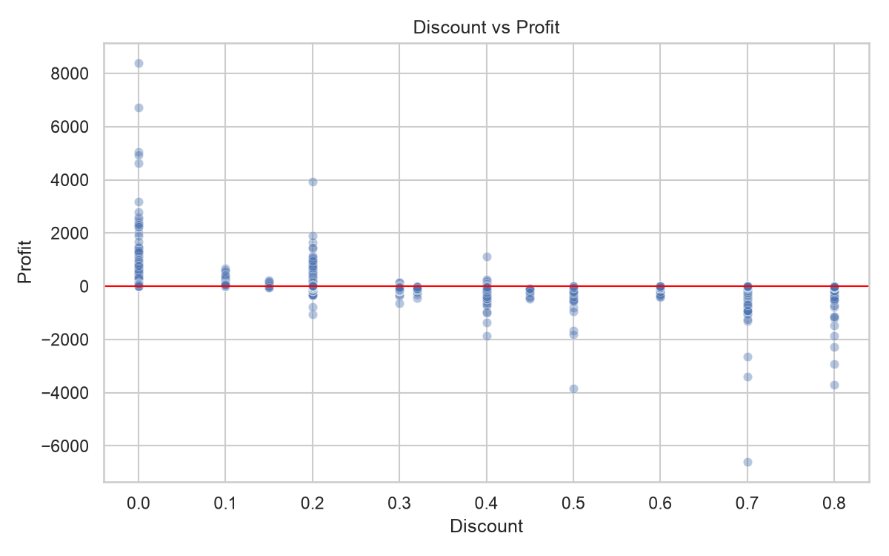
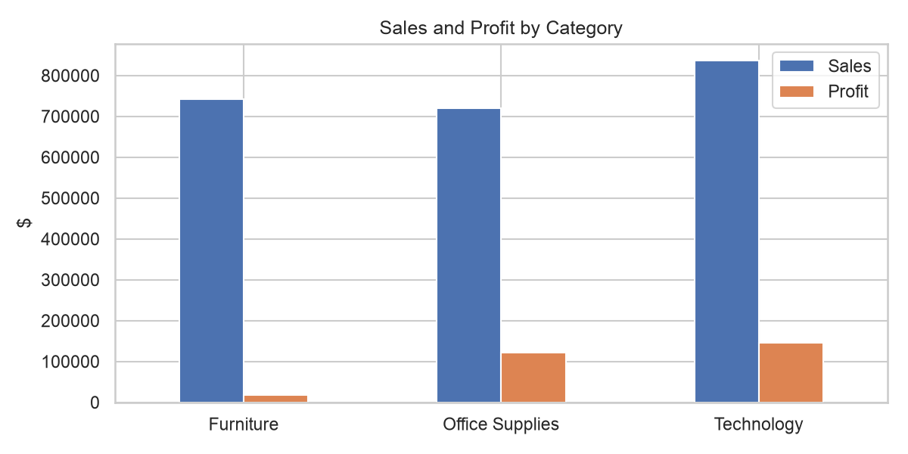
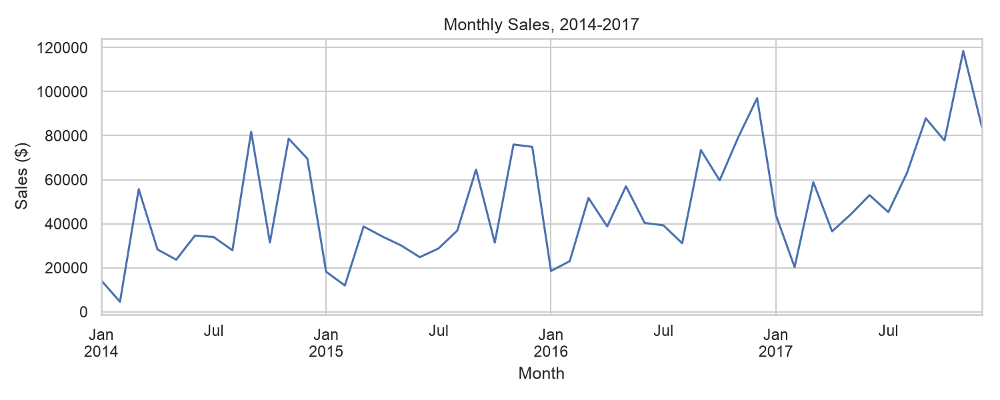
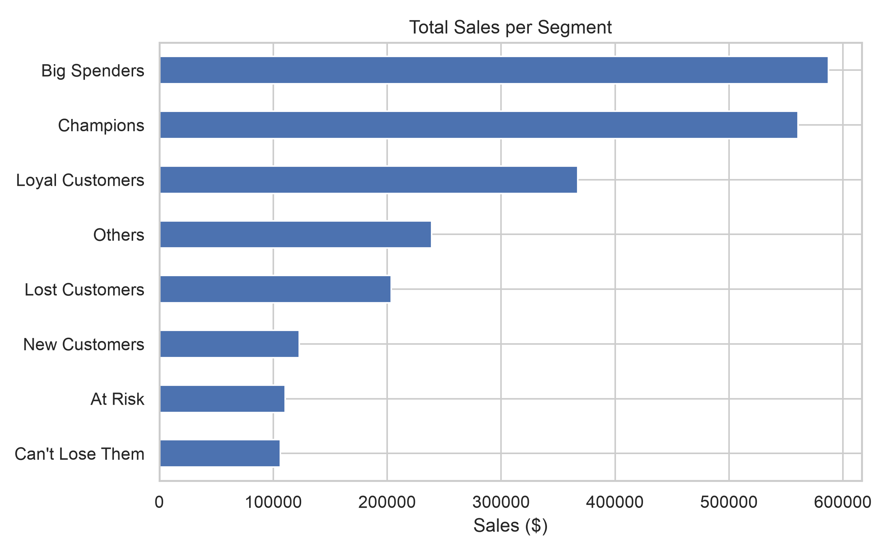

# Superstore Sales Analysis

I analyzed four years of orders (2014-2017, 9,994 rows) from the Kaggle Superstore dataset, which is a fictional US office-supply retailer. I wanted to find out where the company makes and loses money, and which customers are worth holding on to.

I used SQL (SQLite) for the main business questions, and Python (pandas, matplotlib, seaborn) in Jupyter for cleaning, charts and customer segmentation.

There's a one-page version for managers in [reports/executive_summary.md](reports/executive_summary.md).

## Quick numbers

- Total sales: $2.30M
- Total profit: $286k (12.5% margin)
- 5,009 orders, with an average order value of $459

## What I found

### Heavy discounts are where most of the money goes
97% of order lines discounted 30% or more lost money. Together those lines lost about $135k, which is close to half the company's total profit. Products that lose money overall had an average discount of 29%, compared with 12% for products that make money.



### Furniture sells well but barely makes a profit
Furniture is 32% of sales but only has a 2.5% margin, while Technology's margin is 17.4%. Tables (-$17.7k) and Bookcases (-$3.5k) actually lose money. 3 of the 10 best-selling products lose money too, so high sales don't always mean profit.



### Sales grew 51%, with a peak at the end of the year
Sales went from $484k in 2014 to $733k in 2017. September, November and December are the busiest months every year, and January and February are the quietest.



### A small group of customers matters a lot
I scored every customer on recency, frequency and monetary value (RFM) and put them into 8 segments. The top 10% of customers bring in 31% of sales and 43% of profit. The most valuable group is the 80 "Big Spenders", but on average they haven't ordered in about 170 days.



### West is the strongest region and Central the weakest
West leads in both sales and margin (14.9%). Central comes third in sales and has the lowest margin (7.9%).

## What I'd recommend

1. Cap discounts at 20%, with a manager's approval needed for anything above that.
2. Look at Furniture pricing, starting with Tables and Bookcases.
3. Get back in touch with Big Spenders and regulars who've stopped ordering, and give Champions loyalty perks.
4. Plan stock and marketing around September to December.

## How I did it

- [`sql/`](sql/) has six queries, from basic `GROUP BY` up to window functions (`RANK`, running totals), plus a [data dictionary](sql/00_data_dictionary.md).
- [`notebooks/01_cleaning_and_kpis.ipynb`](notebooks/01_cleaning_and_kpis.ipynb) checks data quality, fixes the dates, adds columns (year, month, ship days, margin), and calculates the KPIs and charts.
- [`notebooks/02_rfm_segmentation.ipynb`](notebooks/02_rfm_segmentation.ipynb) does the RFM scoring (1-5), the segments and the top 10% analysis.
- `scripts/load_to_sqlite.py` loads the raw CSV into a SQLite database.

## Running it yourself

```bash
python3 -m venv .venv
source .venv/bin/activate
pip install -r requirements.txt
python scripts/load_to_sqlite.py      # creates data/superstore.db
```

The raw CSV is already in `data/raw/`. To run a query:

```bash
sqlite3 -header -column data/superstore.db < sql/01_sales_by_region.sql
```

Run notebook 01 before notebook 02, because 02 reads the cleaned file that 01 saves.

## Data

[Superstore Dataset on Kaggle](https://www.kaggle.com/datasets/vivek468/superstore-dataset-final)
